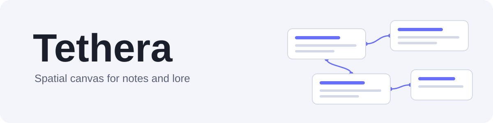

  <picture>
    <source media="(prefers-color-scheme: dark)" srcset="assets/banner-dark.svg">
    
  </picture>

  
  
  
  

  <a href="README.ru.md">Русский</a>

Tethera is a desktop app where notes are cards on an infinite board. Link them with `[[...]]`, drag them around, and see how your ideas connect. Made with Godot 4.

It works two ways, and you choose how much of it you use:

- **As a plain notes canvas.** Write Markdown notes, link them, arrange them, add pictures and text labels. Nothing else is required.
- **As a world-building tool.** Give notes a type (character, place, event, faction, item, or your own) with custom fields, and the canvas can colour, filter and lay them out by type.

A note without a type is just a note. The lore features stay out of the way until you turn them on.

## Download

Get the latest build for Windows, Linux or macOS from the [Releases page](https://github.com/pabrowhat/tethera/releases/latest). Download, unpack and run it. On first launch, pick a folder for your worlds.

The macOS app is not signed. If macOS says it is "damaged", run `xattr -dr com.apple.quarantine ` in Terminal followed by the path to Tethera.app.

## Features

**Notes**

- Markdown with headings, lists, numbered lists, quotes, tables, checklists, code and alignment
- Links between notes with `[[...]]`, with autocomplete, backlinks and broken-link marks
- Renaming a note updates the links that point to it
- Flip a card to see its status, dates, type fields and links
- Edit in a side panel or in a focused Zen mode, with an Edit / View switch

**Canvas**

- Pan and zoom over an infinite board, with a minimap
- Pictures, text labels, decor and a background picture, above or below the notes
- Layout templates: tree, orbit and orbit by type
- Search, a command palette, undo and redo
- Export the canvas as a PNG

**Worlds**

- Several worlds, each with its own notes, types, pictures, trash and backups
- Types with custom fields, colours and filters
- Export and import whole worlds or chosen notes as `.tether` files
- Dark, light and automatic themes; interface in English and Russian

## Your data is yours

Each world is a folder of plain files: Markdown notes with a small JSON header, and JSON for links and types. There is no account and no cloud, and the app does not need a network connection. You can back up, sync or read your notes with any tools you like.

## Run from source

1. Install Godot 4.7.
2. Open the project folder in Godot and run it.

## Guide

- [English](guide/guide_en.md)
- [Русский](guide/guide_ru.md)

## About the project

Tethera is a personal project, made by one person and released when it is ready. Bug reports and ideas are welcome in [Issues](https://github.com/pabrowhat/tethera/issues).

## License

MIT. See [LICENSE](LICENSE).
