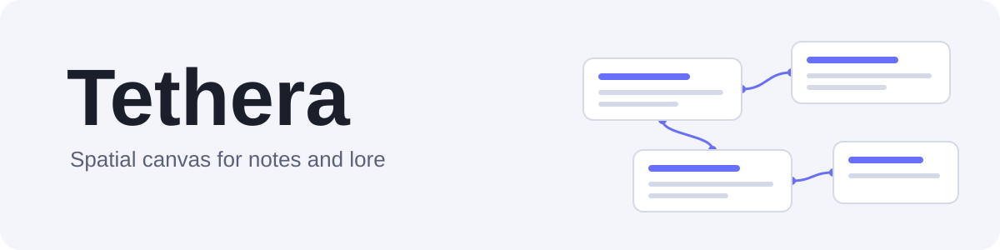

  <picture>
    <source media="(prefers-color-scheme: dark)" srcset="assets/banner-dark.svg">
    
  </picture>

  
  
  
  

  <a href="README.md">English</a>

Tethera – это приложение, где заметки лежат карточками на бесконечной доске. Связывайте их через `[[...]]`, двигайте как хотите и смотрите, как соединяются ваши идеи. Сделано на Godot 4.

Пользоваться можно двумя способами, и вы сами решаете, сколько возможностей использовать:

- **Как обычный холст для заметок.** Пишите заметки в Markdown, связывайте их, расставляйте, добавляйте картинки и текстовые надписи. Больше ничего не требуется.
- **Как инструмент для создания миров.** Дайте заметкам тип (персонаж, место, событие, фракция, предмет или свой) с собственными полями, и холст сможет красить, фильтровать и раскладывать их по типам.

Заметка без типа – просто заметка. Возможности для лора не мешают, пока вы их не включили.

## Скачать

Последнюю сборку для Windows, Linux или macOS можно взять на [странице релизов](https://github.com/pabrowhat/tethera/releases/latest). Скачайте, распакуйте и запустите. При первом запуске выберите папку для миров.

Приложение для macOS не подписано. Если macOS пишет, что оно «повреждено», выполните в Терминале `xattr -dr com.apple.quarantine ` и путь к Tethera.app.

## Возможности

**Заметки**

- Markdown: заголовки, списки, нумерованные списки, цитаты, таблицы, чек-листы, код и выравнивание
- Связи между заметками через `[[...]]`: автодополнение, обратные ссылки, пометки битых связей
- При переименовании заметки ссылки на неё обновляются
- Карточку можно перевернуть и увидеть статус, даты, поля типа и связи
- Правка в боковой панели или в сосредоточенном режиме Zen, переключатель «Правка / Просмотр»

**Холст**

- Перемещение и масштаб по бесконечной доске, миникарта
- Картинки, текстовые надписи, декор и фоновая картинка: над заметками или под ними
- Шаблоны расположения: дерево, орбита и орбита по типам
- Поиск, палитра команд, отмена и повтор
- Экспорт холста в PNG

**Миры**

- Несколько миров, у каждого свои заметки, типы, картинки, корзина и резервные копии
- Типы с собственными полями, цветами и фильтрами
- Экспорт и импорт миров целиком или выбранных заметок в файлы `.tether`
- Тёмная, светлая и автоматическая темы; интерфейс на английском и русском

## Ваши данные принадлежат вам

Каждый мир – это папка с обычными файлами: заметки в Markdown с небольшим JSON-заголовком и JSON для связей и типов. Нет ни аккаунта, ни облака, и приложению не нужен интернет. Копировать, синхронизировать и читать заметки можно любыми инструментами.

## Запуск из исходников

1. Установите Godot 4.7.
2. Откройте папку проекта в Godot и запустите его.

## Гайд

- [English](guide/guide_en.md)
- [Русский](guide/guide_ru.md)

## О проекте

Tethera – личный проект одного человека, релизы выходят, когда готовы. Об ошибках и идеях можно писать в [Issues](https://github.com/pabrowhat/tethera/issues).

## Лицензия

MIT. См. [LICENSE](LICENSE).
